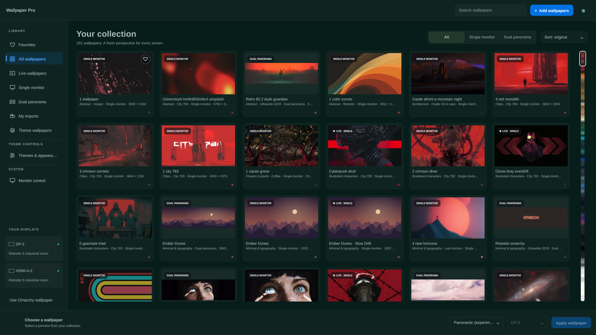

# Wallpaper Pro

An Omarchy shell plugin for a personal image and live wallpaper collection.

**Early development · 0.9.0-alpha.5.** This is a working foundation, not a marketplace release yet.

## Current features

- Browse 15 included wallpapers: six 1920 × 1080 images, six 3840 × 1080 panoramas, and three silent looping videos.
- Filter by live wallpapers, single monitor, dual panorama, My imports, or Themes, and search by wallpaper or theme name.
- Automatically discover installed Omarchy theme wallpapers and generate their thumbnails.
- Browse installed themes ordered by their accent hue, with a matching color swatch and color-family label; search and apply themes in place, inspect the current background, and cycle backgrounds from the in-app Themes & appearance page.
- Import local images and videos through a file picker, with automatically generated thumbnail images.
- Add a folder to recursively import supported images and videos from every subfolder, with progress and duplicate detection.
- Download direct HTTP/HTTPS media links into a private local collection.
- Assign a different image or looping, muted video to each monitor.
- Repeat one image or video on all connected monitors.
- Span a panoramic image or video across the desktop's logical monitor layout.
- Pause video on battery power and behind fullscreen apps (per monitor).
- Follow Omarchy’s colors and open the manager as a normal tiled Hyprland application window.
- Turn off Wallpaper Pro to reveal the wallpaper underneath.
- Keep library and assignments across shell restarts; reconnecting displays use their connector assignments.

Multi-monitor videos use separate players and a shared playback timeline, checking for drift every 500 ms and seeking when drift exceeds 150 ms. Panoramic video is **experimental and not frame locked**; monitor seams may show timing differences. Web imports require a direct media URL with a supported file extension; YouTube, Steam Workshop, Wallpaper Engine projects, HTML pages, and provider galleries are not supported.



## Interface

A macOS-inspired desktop layout combines a library sidebar, a compact search/import toolbar, larger image previews, live-video badges, and a persistent Apply bar. The sidebar shows current monitor assignments. Narrow windows switch to a category selector and compact controls. Window management uses the usual Hyprland shortcuts.

Playback preferences and library removal are under the settings button. All file, folder, URL import, thumbnail, and monitor controls remain available. The manager continues to tile normally in Hyprland.

## Requirements

Omarchy with its Quickshell plugin system, Python 3, ffmpeg (including ffprobe), Qt Quick Controls, Qt Quick Dialogs, and Qt Multimedia with codecs for your videos. No swww, awww, or mpvpaper dependency. Codec availability varies by system.

## Development install

From this checkout:

```sh
omarchy plugin validate .
# Optional Qt GUI interaction tests (Qt Test / qmltestrunner required):
QT_QPA_PLATFORM=offscreen QT_QUICK_BACKEND=software /usr/lib/qt6/bin/qmltestrunner -input tests/qml -o -,txt
```

Install this development version with `omarchy plugin add https://github.com/BraveHart911/wallpaper-pro` and enable `bravehart911.wallpaper-pro` from Omarchy's plugin settings. For a local test, copy this checkout into `~/.config/omarchy/plugins/bravehart911.wallpaper-pro`, rescan with `omarchy-shell shell rescanPlugins`, then enable with `omarchy plugin enable bravehart911.wallpaper-pro`. Do not copy over an existing plugin checkout.

Open Wallpaper Pro from its bar icon. Choose **+ Add wallpapers** to add files, a folder, or a web link. Select a library card, select the display mode and monitor, then choose **Apply wallpaper**. Choose **Use Omarchy wallpaper** to hand the desktop back to the existing background provider. Applying an individual assignment switches to individual mode; other saved individual assignments remain available.

Wallpaper Pro adds click-through bottom-layer windows and does not rewrite Omarchy's theme, wallpaper, Hyprland startup, or other plugins' settings. Other live wallpaper plugins may compete for the same desktop layer; turn those off through their own controls while using Wallpaper Pro. Stock backgrounds remain underneath.

The manager stays loaded when closed so wallpapers continue playing. Disabling the plugin removes its renderer; turning wallpapers off destroys its video players. Plugin updates may require `omarchy restart shell` to replace already loaded QML components.

## Hyprland and Omarchy compatibility

Wallpaper surfaces stay on the bottom layer, accept no keyboard focus, and have an empty input region so mouse actions pass through. They reserve no screen space and stay below application windows, bars, menus, and lock surfaces. Wallpaper Pro does not change Hyprland settings, startup commands, theme files, idle settings, or other plugins, and never kills other wallpaper processes.

The manager is a regular Wayland application window, so Hyprland controls its tiling, movement, resizing, workspace placement, and fullscreen state. Closing it with the window-manager shortcut keeps wallpapers running, and the bar icon reopens it. The gallery and controls adapt to narrower tiles.

The manager uses Omarchy’s background and text colors with a blue action accent; theme changes update its colors without overriding the wallpaper you selected. **Use Omarchy wallpaper** removes Wallpaper Pro’s wallpaper surfaces and video players, revealing the stock or custom background provider underneath. Omarchy theme and workspace wallpapers can continue updating underneath while Wallpaper Pro is active.

Video pauses on the monitor occupied by a fullscreen application. Other monitors continue playing, and playback resumes when fullscreen ends. `fullscreen off` disables this behavior. Connector assignments survive unplug/replug; panoramic geometry uses logical output coordinates and handles empty layouts safely. Mixed scale, portrait, and negative positions are covered by geometry tests; physical hotplug and display sleep testing remain on the release checklist.

The manager warns about potentially competing full-screen wallpaper surfaces. It reports these without stopping them; use one active live wallpaper renderer per screen. Run `python3 scripts/wallpaper-pro.py doctor` for the same read-only check. Diagnostics inspect Hyprland layers only when the manager opens or the command runs.

## Sort by color

Use the sort menu above the gallery to choose **Sort: color**, **Sort: name**, or the original library order. Color sorting follows dominant hue through the spectrum, then black/gray/white by brightness; previews without color metadata appear last. Each card includes a small color swatch, and its tooltip gives the color name.

With **Sort: color** selected, the right-hand scrollbar becomes a spectrum sampled from the wallpapers in the current category and search. Click a color to jump to its section, drag to scrub through colors, or use the mouse wheel to scroll. The hover label identifies the color and position in the collection. Tab to the spectrum for arrow-key, Page Up/Down, Home, and End navigation. Browsing never applies or changes a wallpaper. Other sort modes use the regular scrollbar.

Colors are sampled from the actual thumbnail, including representative video frames. New imports are analyzed immediately. Existing items and theme wallpapers are analyzed by the background discovery process. Results are cached and refreshed when a thumbnail changes. The selected sort order is saved and applies within every category and search without changing wallpaper assignments.

## Smart color + context grouping

In Settings, **Enable smart grouping** installs an isolated local runtime and the CLIP visual model. Node.js (18+) and npm are required for setup. Tools and model occupy approximately 530 MB on disk. Images are processed locally; normal analysis explicitly disables remote model access. Model weights and dependencies are downloaded once, separately from the plugin checkout.

With grouping enabled, the color sort becomes **Color + context**:

1. Color families remain primary: 30-degree hue bands, followed by dark, gray, and light neutrals.
2. Within each family, visual subject groups keep forests, mountains, oceans, cities, space, technology, animals, abstract art, and other subjects together.
3. Within each subject, visual embeddings arrange similar compositions next to each other. Fine hue and brightness break ties.

Labels come from image pixels, never filename keywords. Whole-image and center views are combined, with extra edge views for wide panoramas and tall images. Videos are classified from their representative thumbnail. Suggested subjects appear on cards and in search; uncertain matches are marked in the tooltip. Automatic classification can still mistake ambiguous artwork.

Embeddings and labels are cached. Only new or changed thumbnails need image-model inference; changing subject prompts or group membership can reuse embeddings. Importing files/folders triggers background analysis when enabled. Disable **Group by color, then image context** to return to strict hue sorting. Wallpaper assignments are not changed by either mode.

```sh
python3 scripts/wallpaper-pro.py install-context
python3 scripts/wallpaper-pro.py sync-themes
python3 scripts/wallpaper-pro.py context off  # optional: strict color sorting
```

See [model and runtime notes](context/NOTICE.md). The Omarchy plugin installer itself does not run setup hooks or download the image model.

## Automatic theme library

While the plugin is enabled, Wallpaper Pro discovers wallpapers on startup, when the manager opens, and every minute in the background—even with the manager closed. Newly installed theme wallpapers appear automatically under **Themes**, alongside their normal image/video categories. Settings also offers **Sync theme wallpapers** for an immediate check.

Discovery reads stock themes at `$OMARCHY_PATH/themes` (default `/usr/share/omarchy/themes`), user themes at `$XDG_CONFIG_HOME/omarchy/themes`, and additional theme backgrounds at `$XDG_CONFIG_HOME/omarchy/backgrounds`. The default config root is `~/.config`. Subfolders, linked theme directories, images, videos, and GIFs are included. Symlink loops are avoided. Identical media is deduplicated by content and tagged with its source themes; existing personal imports are preserved.

Theme media is indexed in place rather than copied. Thumbnails and a file-metadata cache are stored in Wallpaper Pro's data directory. Only new or changed files need decoding, and scans do not hold the settings lock while generating previews. Discovery does not change active wallpapers, monitor assignments, or Omarchy files. Unused removed theme entries leave the catalog; referenced selections and assignments are retained.

The first scan can take time for large collections. You can continue using the app while it runs. Later scans reuse cached metadata and previews. Failed media is skipped and reported in `themeSyncReport` rather than stopping discovery.

```sh
python3 scripts/wallpaper-pro.py sync-themes
```

## Add a folder

Choose **+ Add wallpapers → Add folder & subfolders…** and select your wallpaper collection. Wallpaper Pro scans that folder and all nested subfolders, copies supported media into its managed library, and generates a thumbnail for each added image or video. The window shows file-by-file progress and a final count of added files, duplicates, failures, and unsupported files.

A damaged or unreadable file does not stop the remaining imports. Completed imports are saved as the batch runs. Originals and active wallpaper assignments remain unchanged. Duplicate detection uses file contents, so adding the folder again imports new media without creating duplicate library entries.

Folder imports are snapshots, not background folder watchers. Symbolic links and Wallpaper Pro's own cache directories are excluded from recursive scanning. Existing import size and format limits apply to each file.

```sh
python3 scripts/wallpaper-pro.py import-folder '/path/to/wallpapers'
```

## Thumbnail previews

Every new image or video import gets a cached JPEG preview. Videos use a representative frame from a short sample, with a fallback for clips shorter than one second. Opening the library also generates missing previews for older imports and replaces deleted cache files. Your wallpapers and assignments stay intact.

Previews live in `$XDG_DATA_HOME/wallpaper-pro/thumbnails` (default `~/.local/share/wallpaper-pro/thumbnails`). Run `python3 scripts/wallpaper-pro.py thumbnails --force` to rebuild imported previews. An existing unreadable or missing media file stays in the library with a preview error instead of preventing other entries from loading.

## Command line

```sh
python3 scripts/wallpaper-pro.py import '/path/to/image.png'
python3 scripts/wallpaper-pro.py import 'https://example.org/wallpaper.mp4'
python3 scripts/wallpaper-pro.py status
python3 scripts/wallpaper-pro.py apply MEDIA_ID --mode individual --monitor DP-2
python3 scripts/wallpaper-pro.py apply MEDIA_ID --mode all
python3 scripts/wallpaper-pro.py apply MEDIA_ID --mode span
python3 scripts/wallpaper-pro.py off
```

`MEDIA_ID` comes from `status`. `unassign MONITOR` clears one saved monitor assignment; `battery on` and `battery off` control battery pausing. `omarchy-shell wallpaper-pro status` reports renderer state, per-monitor playback positions, and decoder errors while the plugin is enabled. `fullscreen on` and `fullscreen off` control fullscreen pausing. `remove MEDIA_ID` forgets an unassigned library entry; it retains the cached media file. Imports copy local files, leaving the originals untouched. Downloads have a 512 MiB limit and a 30-second socket timeout. Imports use ffprobe to reject files without a readable video/image stream. This checks stream metadata, not every frame; playback errors can still occur.

Settings: `$XDG_CONFIG_HOME/wallpaper-pro/settings.json` (default `~/.config/wallpaper-pro/settings.json`). Media: `$XDG_DATA_HOME/wallpaper-pro/library` (default `~/.local/share/wallpaper-pro/library`). Settings include source URLs, so avoid sharing them if URLs contain private access tokens. Nothing uploads your media or sends analytics.

## Remove

Choose **Use Omarchy wallpaper**, then run `omarchy plugin remove bravehart911.wallpaper-pro`. Your collection and settings remain for reinstalling. Delete those two Wallpaper Pro data directories manually if you want to remove them permanently.

## Checks

```sh
python3 -m unittest discover -s tests -v
omarchy plugin validate .
# Optional Qt GUI interaction tests (Qt Test / qmltestrunner required):
QT_QPA_PLATFORM=offscreen QT_QUICK_BACKEND=software /usr/lib/qt6/bin/qmltestrunner -input tests/qml -o -,txt
```

A graphical playback smoke test (briefly shows test media, without saving settings):

```sh
WALLPAPER_PRO_SMOKE_KIND=video WALLPAPER_PRO_SMOKE_MEDIA=file:///absolute/path/test.mp4 quickshell -p SmokeTest.qml
```

A full installed-plugin session test is available with `python3 tests/integration_session.py`. It requires two monitors, temporarily switches wallpapers, generates its own fixtures, and restores the exact original settings in a `finally` block. It is a manual graphical-session test, separate from CI.

A manual fullscreen test, `python3 tests/fullscreen_session.py`, creates its own temporary window, verifies per-monitor pause/resume, then restores wallpaper settings and focus. It never changes your existing applications’ fullscreen state.

Run `python3 tests/window_session.py` to check that the installed manager is a tiled client, has no manager layer-shell surface, and can be closed by Hyprland and reopened through plugin toggle.

See [release checklist](docs/RELEASE.md) for remaining integration testing and marketplace steps. The original starter artwork and videos in `assets/library/` are bundled under this repository’s MIT license. Rebuild them with `python3 scripts/build-starter-library.py` (ffmpeg required). The library appears automatically without changing your active wallpaper. Panoramic selections automatically choose spanning mode; you still click Apply to change the desktop. Import only media you have permission to use.
